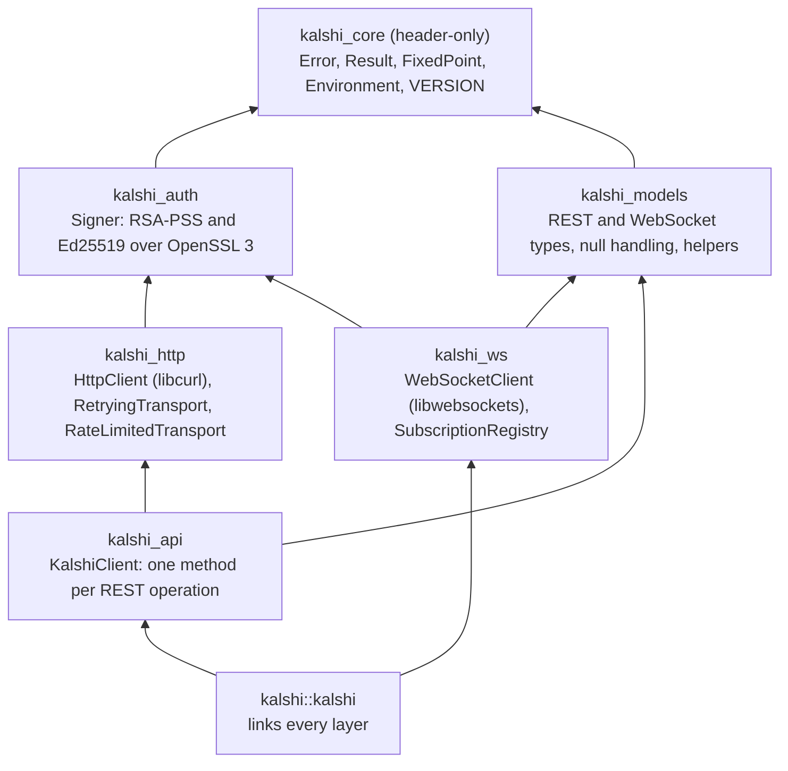
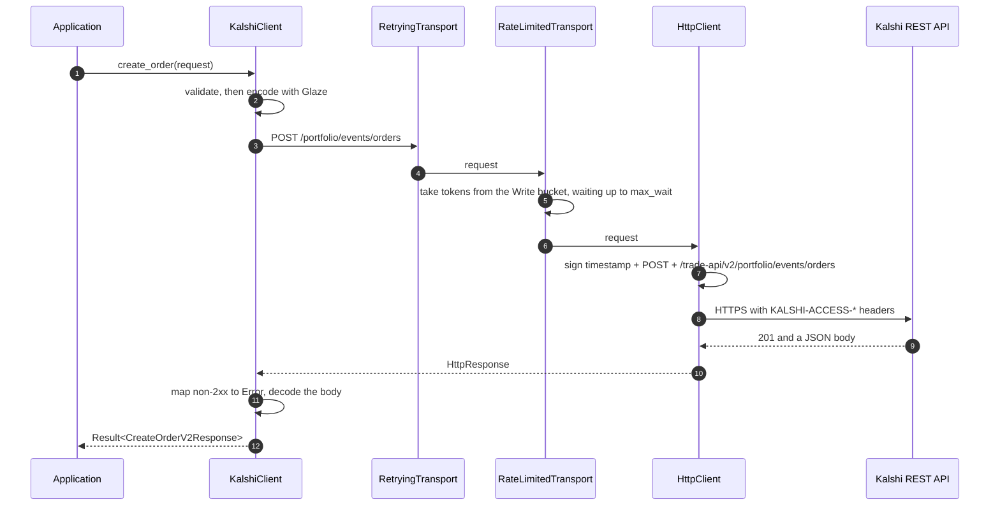
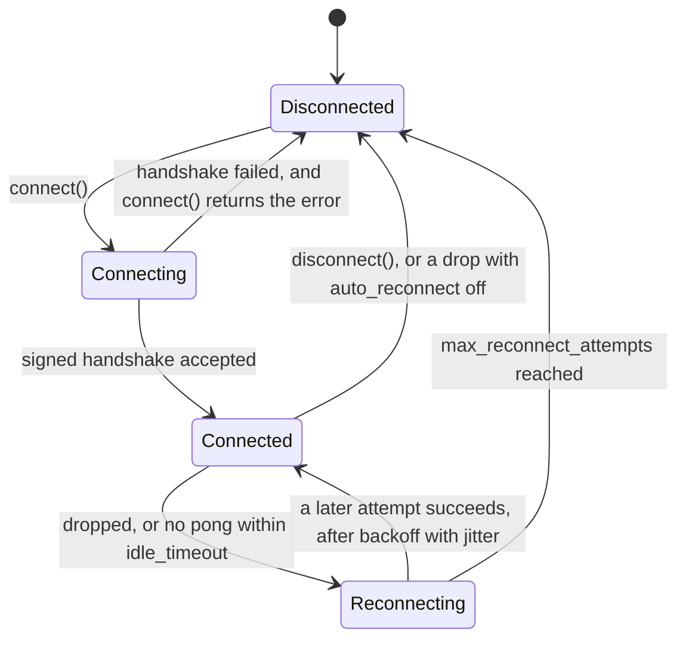
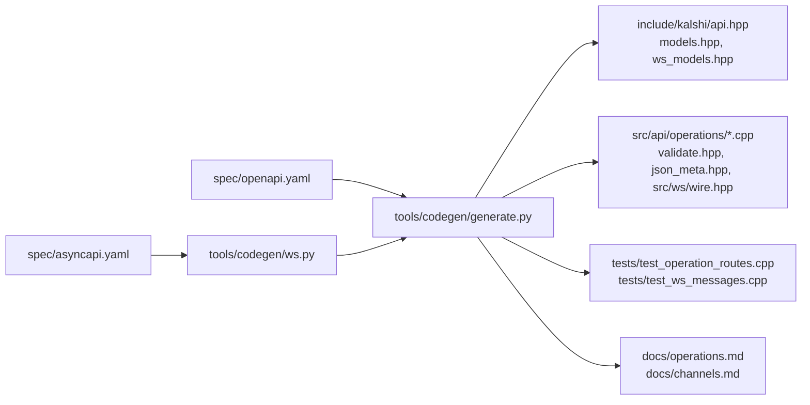

# Architecture

kalshi-cpp is a C++23 client for Kalshi's Predictions REST and WebSocket APIs.
This page explains how the pieces fit together. [CONTRIBUTING.md](CONTRIBUTING.md)
covers building and testing, and [docs/](docs/) has the per-operation and
per-channel reference.

## Upstream contracts

Both APIs come from Kalshi's published documents, kept byte-identical in
`spec/`. [docs/research.md](docs/research.md) records their versions and
SHA-256 hashes and explains how to refresh them.

| Interface | Source | Local copy | Version | Becomes |
| --- | --- | --- | --- | --- |
| REST | <https://docs.kalshi.com/openapi.yaml> | [`spec/openapi.yaml`](spec/openapi.yaml) | OpenAPI 3.37.0 | 145 `KalshiClient` methods, their request and response types, routes, and local validation |
| WebSocket | <https://docs.kalshi.com/asyncapi.yaml> | [`spec/asyncapi.yaml`](spec/asyncapi.yaml) | AsyncAPI 2.0.0 | 14 channels, 33 message types, subscribe and update parameters, and frame dispatch |

Kalshi's Margin API has its own host, authentication, and risk model, so this
client leaves it out.

## Layers

CMake targets are layered so each one links only what it needs. WebSocket and
REST both build on the models; neither depends on the other.



Public headers live in `include/kalshi/`; implementation-only types stay in
`src/`. Glaze is a private build dependency: installed headers never include
it, so consumers need only OpenSSL, libcurl, and libwebsockets.

## Errors and values

- Every public operation returns `kalshi::Result<T>`, which is
  `std::expected<T, kalshi::Error>`, and does not throw. `Error::code`
  distinguishes local rejection, authentication, rate limits, server errors,
  network failures, and parse failures.
- Prices and contract counts arrive as `FixedPoint` decimal strings and convert
  exactly to integers at a chosen scale, or fail instead of rounding.
- Glaze reads and writes every JSON payload through compile-time reflection.
  When Kalshi sends `null` for a field its spec marks non-null, the parser
  strips null members and tries once more, but only after validating the whole
  document.

## REST requests

`KalshiClient` validates each request, encodes it, and hands it to an
`HttpTransport`. Transports are decorators, so callers compose retries and
rate limiting around the libcurl client, or substitute a test double.



- **Signing.** `Signer` signs `timestamp_ms + METHOD + path`. The path runs
  from the host root, including `/trade-api/v2`, and excludes the query
  string; the body is not signed. RSA keys sign with RSA-PSS, SHA-256, and a
  digest-length salt. Ed25519 keys sign the message directly.
- **Retries.** `RetryingTransport` retries 429s, and retries network errors,
  408s, and 5xx responses for GET requests, with jittered exponential backoff
  that honors `Retry-After`. Writes repeat after those failures only when
  `RetryPolicy::retry_writes` is set, because the first attempt may already
  have placed or canceled an order.
- **Rate limits.** `RateLimitedTransport` keeps token buckets for Kalshi's
  Read and Write budgets, plus the dedicated balance and intra-account
  transfer buckets. Each operation is charged to the bucket Kalshi assigns it,
  at its endpoint cost times the number of items in a batch.
  `rate_limit_config()` builds the buckets from the account's own limits.

## WebSocket streaming

`WebSocketClient` runs libwebsockets on its own network thread. The handshake
carries the same `KALSHI-ACCESS-*` headers as REST, signed over `GET` and
`/trade-api/ws/v2`; there is no separate login message.



- **Callbacks.** `on_message`, `on_error`, and `on_state_change` run on the
  network thread. They may call any client method, including the destructor,
  but should return quickly.
- **Subscriptions.** `SubscriptionRegistry` gives each subscription a stable
  `ws::Subscription` handle while the server's `sid` changes across
  reconnects. Commands sent before the server confirms a subscription wait for
  its `sid`. After a reconnect the client subscribes again with the markets,
  indices, underlyings, and matches each subscription last confirmed.
- **Sequence gaps.** On sequenced channels a skipped `seq` is reported to
  `on_error`. For `orderbook_delta`, the client also requests fresh snapshots
  of the subscribed markets, unless `WsConfig::resync_on_gap` is off.
- **Liveness.** The client pings when no pong has arrived for
  `ping_interval` and drops the connection when none arrives within
  `idle_timeout`. Kalshi sends its own pings only after 10 seconds without a
  data message.

## From the specs to C++

`tools/codegen/generate.py` reads both documents and writes the REST client,
the WebSocket types, their Glaze metadata, local validation, route and message
tests, and the operation and channel catalogs. `make codegen` runs it, and
`make lint` fails when the committed output is stale.



The generator stops with an error on a spec feature it cannot map, such as
`oneOf`, rather than dropping it. When Kalshi's contract changes, the
generator is extended first; its checks are never loosened.

Each operation follows the same shape. This is `create_order`, from
`POST /portfolio/events/orders` (`CreateOrderV2`):

```cpp
Result<CreateOrderV2Response> KalshiClient::create_order(const CreateOrderV2Request& body) {
    if (Result<void> valid = detail::validate(body); !valid) {
        return std::unexpected(std::move(valid.error()));
    }
    return detail::decode<CreateOrderV2Response>(Impl::send(impl_.get(), HttpMethod::POST,
                                                            std::string{"/portfolio/events/orders"},
                                                            detail::encode(body), "create_order"));
}
```

## Design choices

| Choice | Why |
| --- | --- |
| `std::expected` everywhere | Failures are values the caller must handle; no exceptions cross the API. |
| Exact `FixedPoint` decimals | Prices and counts never pass through binary floating point. |
| Glaze reflection | Parsing builds typed structs directly; REST pages parse about 35 times faster than the hand-written scanners it replaced. |
| Transport decorators | Retries, pacing, logging, and tests compose without changing `KalshiClient`. |
| Conservative write retries | A repeated order or cancel can double its effect, so writes retry only on request. |
| Stable subscription handles | Application code keeps its handles while reconnects change the server's `sid`. |
