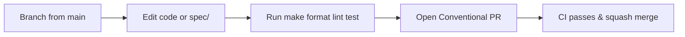

# Contributing

Report security issues privately via [SECURITY.md](SECURITY.md), not in a public issue.

## Set up

```bash
git clone https://github.com/Reddimus/kalshi-cpp.git
cd kalshi-cpp
```

On Ubuntu 24.04 (apt ships CMake older than 3.31):

```bash
sudo apt install build-essential ninja-build pkg-config clang-format-18 python3-yaml \
    pipx jq libssl-dev libcurl4-openssl-dev libwebsockets-dev
pipx install cmake && pipx ensurepath   # then open a new shell
make test
```

On macOS, `make` picks up Homebrew's keg-only `llvm@18` automatically, and PyYAML runs from a virtual environment:

```bash
brew install cmake ninja pkg-config libwebsockets llvm@18 jq
# Link against the same OpenSSL that Homebrew's libwebsockets uses; CMake warns otherwise.
export CMAKE_PREFIX_PATH="$(brew --prefix "$(brew deps libwebsockets | grep -E '^openssl@[0-9]+$' | head -n 1)")"
python3 -m venv .venv && .venv/bin/pip install pyyaml
export PYTHON=.venv/bin/python
make test lint
```

Windows builds use vcpkg; see the `build-windows` job in `.github/workflows/ci.yml`.

## Everyday commands

```bash
make test            # Release build and tests
make debug           # Debug build in build-debug/
make sanitize tsan   # ASan + UBSan and ThreadSanitizer
make tidy            # clang-tidy build
make lint            # clang-format 18, explicit-type audit, generated-code check
make format          # Apply clang-format
make codegen         # Regenerate REST/WebSocket code and docs from spec/
make docs            # Doxygen API reference in build-docs/html (needs Doxygen)
make bench           # Google Benchmark suite
make consumers       # Build installed and FetchContent consumers
make coverage        # lcov report (needs lcov)
make lint-docs       # markdownlint (needs markdownlint-cli2)
```

Run `make format lint test` before pushing, plus `make lint-docs` after editing Markdown (`make install-hooks` runs `make lint` on each commit). CI checks Linux, macOS, Windows, sanitizers, `clang-tidy`, and consumers.

`make tidy` needs clang-tidy 18. On Ubuntu, match CI with clang and `libc++`:

```bash
make tidy CMAKE_ARGS="-DCMAKE_CXX_COMPILER=clang++-18 -DCMAKE_CXX_FLAGS=-stdlib=libc++"
```

## Generated code

`tools/codegen/generate.py` generates the REST client from `spec/openapi.yaml` and WebSocket types from `spec/asyncapi.yaml` (`include/kalshi/api.hpp`, `models.hpp`, `ws_models.hpp`, `src/api/operations/`, `src/api/validate.hpp`, `src/models/json_meta.hpp`, `src/ws/wire.hpp`, `tests/test_operation_routes.cpp`, `tests/test_ws_messages.cpp`, `docs/operations.md`, and `docs/channels.md`).

After editing a spec, generator script, or `tools/codegen/*.in` template, run `make codegen` and commit the result (`make lint` rejects stale output). See [docs/research.md](docs/research.md) for spec refresh steps, and review `REQUIRED_ALTERNATIVES` when updating exit-trigger contracts.

The generator fails fast on unmapped spec features such as `oneOf`, `PATCH`, or header parameters rather than silently dropping them. `tools/codegen/test_codegen.py` covers these checks as part of `make lint`.

## Code style

- Return `kalshi::Result<T>` (`std::expected<T, Error>`) from public APIs; do not throw exceptions.
- Spell out local variable types (`auto` is allowed only for structured bindings, lambdas, iterators, `// auto-ok: reason` annotations, or `tools/cpp_auto_allowlist.txt`; checked by `make lint`).
- Follow `.clang-format` (tabs, 100 columns, project headers before system headers).
- Read/write JSON through Glaze; null-stripping fallback runs only after validating the full payload.
- Keep tests offline using an injected `HttpTransport` or the local servers in `tests/`.

## Pull requests



- Name branches `feat/`, `fix/`, `perf/`, `docs/`, `ci/`, `refactor/`, `test/`, or `chore/`.
- Title PRs using [Conventional Commits](https://www.conventionalcommits.org/), e.g. `fix(ws): keep subscriptions across reconnects` (PRs are squash-merged).
- Write PR descriptions, commit titles, and documentation for public readers: keep them short, clear, and concrete, and add diagrams or screenshots when visual context helps.
- Record user-visible changes in `CHANGELOG.md` under `[Unreleased]`.

## Releases

1. Set `VERSION` in `CMakeLists.txt`, move `[Unreleased]` entries to `[X.Y.Z]` with updated compare links in `CHANGELOG.md` (using absolute URLs), and update `GIT_TAG` in `README.md`.
2. Merge that release PR to `main`.
3. Tag and push `git tag vX.Y.Z && git push origin vX.Y.Z`. `release.yml` publishes the GitHub release once CI passes, and `docs.yml` deploys the API reference.
4. Compute the release archive hashes (`curl -sL https://github.com/Reddimus/kalshi-cpp/archive/refs/tags/vX.Y.Z.tar.gz | shasum -a 512`, or `-a 256` for Conan) and update both downstream registries from your forks:
   - **vcpkg:** update `version` in `ports/kalshi-cpp/vcpkg.json` and `SHA512` in `portfile.cmake`, run `./vcpkg x-add-version kalshi-cpp`, commit, and open a PR against `microsoft/vcpkg`.
   - **ConanCenter** (once [kalshi-cpp#31050](https://github.com/conan-io/conan-center-index/pull/31050) merges): update `recipes/kalshi-cpp/config.yml` and `recipes/kalshi-cpp/all/conandata.yml`, and open a PR against `conan-io/conan-center-index`.

While in `0.x`, minor releases may introduce API changes; patch releases contain only fixes.

## License

Contributions are licensed under the repository's MIT license.
