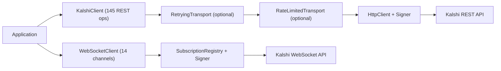

# kalshi-cpp

[](https://github.com/Reddimus/kalshi-cpp/actions/workflows/ci.yml)
[](https://github.com/Reddimus/kalshi-cpp/releases)

A C++23 client for Kalshi's Predictions API covering every
[REST operation](docs/operations.md) and [WebSocket channel](docs/channels.md).
Types and method names come directly from Kalshi's OpenAPI and AsyncAPI contracts in
[`spec/`](https://github.com/Reddimus/kalshi-cpp/tree/main/spec) and match
[Kalshi's API docs](https://docs.kalshi.com) (Kalshi's Margin and Perpetuals API
is out of scope). Browse every type and method in the
[API reference](https://reddimus.github.io/kalshi-cpp/).

## Overview



See [ARCHITECTURE.md](https://github.com/Reddimus/kalshi-cpp/blob/main/ARCHITECTURE.md)
for layer boundaries, request sequences, WebSocket connection states, and code generation.

## Install

Requires a C++23 compiler, CMake 3.31+, OpenSSL 3+, libcurl 7.65+, and
libwebsockets. When libwebsockets uses OpenSSL, `kalshi-cpp` must link against
that same OpenSSL build; CMake warns when it can tell they differ. CI tests Ubuntu 24.04
(GCC 13), macOS Apple silicon (Apple Clang, deployment target 13.3+), and
Windows (MSVC with [`vcpkg.json`](https://github.com/Reddimus/kalshi-cpp/blob/main/vcpkg.json)).

```bash
# macOS: build against the OpenSSL that Homebrew's libwebsockets links
brew install cmake libwebsockets pkg-config
export CMAKE_PREFIX_PATH="$(brew --prefix "$(brew deps libwebsockets | grep -E '^openssl@[0-9]+$' | head -n 1)")"

# Ubuntu 24.04 (apt CMake is older than 3.31)
sudo apt install build-essential pkg-config pipx libssl-dev libcurl4-openssl-dev libwebsockets-dev
pipx install cmake && pipx ensurepath   # then open a new shell
```

Add `kalshi-cpp` via CMake `FetchContent`:

```cmake
include(FetchContent)
FetchContent_Declare(kalshi
  GIT_REPOSITORY https://github.com/Reddimus/kalshi-cpp.git
  GIT_TAG v0.9.9)
FetchContent_MakeAvailable(kalshi)
target_link_libraries(myapp PRIVATE kalshi::kalshi)
```

Or add `kalshi-cpp` to `vcpkg.json` with [vcpkg](https://vcpkg.io) to install
OpenSSL, libcurl, and libwebsockets automatically; both vcpkg and
`cmake --install` expose `find_package(kalshi CONFIG REQUIRED)` and
`kalshi::kalshi`. Until 1.0, minor releases may break the API; see
[CHANGELOG.md](CHANGELOG.md) for migration notes.

## Read market data

Public endpoints need no API key.

```cpp
#include <kalshi/kalshi.hpp>
#include <iostream>

int main() {
    kalshi::KalshiClient client{kalshi::HttpClient{}};

    kalshi::GetMarketsParams params;
    params.series_ticker = "KXHIGHNY";   // New York City's daily high temperature
    params.status = kalshi::GetMarketsStatus::Open;

    kalshi::Result<kalshi::GetMarketsResponse> page = client.get_markets(params);
    if (!page) {
        std::cerr << page.error().message << '\n';
        return 1;
    }
    for (const kalshi::Market& market : page->markets) {
        std::cout << market.ticker << ' ' << market.yes_bid_dollars << '\n';
    }
}
```

Use `kalshi::collect_pages` to paginate across cursors automatically.

## Errors

Failing calls return `kalshi::Result<T>` (`std::expected<T, kalshi::Error>`)
instead of throwing exceptions. Check `Error::code` (for example `RateLimited`
or `NetworkError`), `Error::http_status`, and `Error::api_code` for exchange
rejections.

## Authenticate

Create an API key at <https://kalshi.com/account/profile>, save the private key,
and note the key ID. `Signer` loads unencrypted RSA and Ed25519 PEM keys:

```cpp
kalshi::Result<kalshi::Signer> signer = kalshi::Signer::from_pem_file("your-key-id", "kalshi.key");
if (!signer) {
    std::cerr << signer.error().message << '\n';
    return 1;
}
kalshi::KalshiClient client{kalshi::HttpClient{*signer}};   // Signer is cheap to copy
kalshi::Result<kalshi::GetBalanceResponse> balance = client.get_balance();
```

Kalshi's demo exchange uses play money and separate keys. Pass
`kalshi::ClientConfig::for_environment(kalshi::Environment::Demo)` to
`HttpClient`, or `kalshi::WsConfig::for_environment(kalshi::Environment::Demo)`
to `WebSocketClient`.

## Place an order

This places a live order unless configured for `Environment::Demo`.

```cpp
kalshi::CreateOrderV2Request order;
order.ticker = "KXHIGHNY-26SEP25-T70";
order.side = kalshi::BookSide::Bid;   // Bid buys Yes, Ask sells Yes
order.count = "10.00";                // contracts
order.price = "0.5600";               // dollars
order.time_in_force = kalshi::TimeInForce::GoodTillCanceled;
order.self_trade_prevention_type = kalshi::SelfTradePreventionType::TakerAtCross;

kalshi::Result<kalshi::CreateOrderV2Response> placed = client.create_order(order);
```

Counts and prices are fixed-point decimal strings (`order.price = "56c"` and
missing required fields fail locally with `InvalidRequest`).

## Stream updates

```cpp
kalshi::WebSocketClient ws(*signer);
ws.on_message([](const kalshi::WsMessage& message) {
    using Delta = kalshi::ws::Update<kalshi::ws::OrderbookDelta>;
    if (const Delta* delta = std::get_if<Delta>(&message)) {
        std::cout << delta->msg.market_ticker << ' ' << delta->msg.delta_fp << '\n';
    }
});
kalshi::Result<kalshi::ws::Subscription> book = ws.subscribe(
    kalshi::ws::Channel::OrderbookDelta, {.market_tickers = {"KXHIGHNY-26SEP25-T70"}});
kalshi::Result<void> connected = ws.connect();
```

- `connect()` blocks until the connection opens or fails; callbacks run on the
  network thread until `disconnect()` or destruction.
- On dropped connections, `WebSocketClient` reconnects, resubscribes, and keeps
  existing `ws::Subscription` handles valid.
- Sequence gaps on sequenced channels invoke `on_error` and request fresh
  snapshots on `orderbook_delta`. See [docs/channels.md](docs/channels.md) for
  each channel's message types.

## Retries and rate limits

Stack `RateLimitedTransport` and `RetryingTransport` around `HttpClient`:

```cpp
std::shared_ptr<kalshi::HttpClient> http = std::make_shared<kalshi::HttpClient>(*signer);
std::shared_ptr<kalshi::RateLimitedTransport> paced =
    std::make_shared<kalshi::RateLimitedTransport>(http, kalshi::RateLimitConfig{});
kalshi::KalshiClient client{std::make_shared<kalshi::RetryingTransport>(paced)};
```

- **Safe write retries:** By default, `RetryingTransport` retries `POST`, `PUT`,
  and `DELETE` only on HTTP `429` so writes are not duplicated when the outcome
  is unknown.
- **Tier pacing:** `RateLimitConfig{}` matches Kalshi's Basic tier (1 call/s for
  balance requests on Basic and Advanced, 5/s on higher known tiers; write pacing
  is conservative across exchange shards).
- **Account calibration:** Pass `get_account_api_limits()` and
  `get_account_endpoint_costs()` to `kalshi::rate_limit_config()`, and share
  one paced transport per account.
- **Body size limits:** `ClientConfig::max_response_bytes` and
  `WsConfig::max_message_bytes` default to 64 MiB (`0` disables). Larger HTTP
  bodies return `ParseError` after the server has processed the request, so check
  whether writes took effect before retrying.

## Examples

[`examples/`](https://github.com/Reddimus/kalshi-cpp/tree/main/examples) includes
four runnable programs (public market data, portfolio, demo order placement, and
live order book streaming). Run `make run-market_data` without a key, or follow
the [examples README](https://github.com/Reddimus/kalshi-cpp/blob/main/examples/README.md)
to configure `.env` for `make run-<name>`.

## Contributing

See [CONTRIBUTING.md](CONTRIBUTING.md) for building, testing, spec updates, and
releases, and [SECURITY.md](SECURITY.md) for reporting vulnerabilities.
